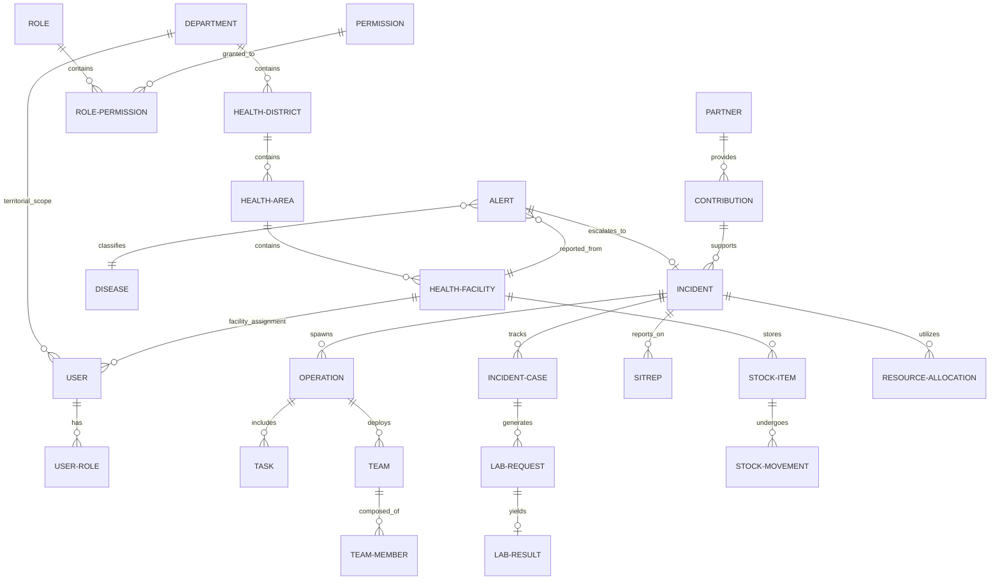

# COUSP-MIS : Dossier d'Architecture & Modélisation Conceptuelle (Phase 1)
**Système National de Gestion de l'Information des Urgences de Santé Publique**
*République du Congo – Ministère de la Santé et de la Population*

---

## 1. Synthèse Exécutive et Gouvernance

Le **COUSP-MIS** (*Centre des Opérations d'Urgence de Santé Publique – Management Information System*) est la plateforme numérique souveraine unifiée pour la détection précoce, l'alerte, la coordination tactique, la gestion des incidents, des cas épidémiologiques, des laboratoires, de la logistique stratégique, des SITREP (Situation Reports) et des ressources opérationnelles sur l'ensemble des 12 départements de la République du Congo.

### 1.1 Cadre Territorial et Sanitaire Congolais
Le système applique une double hiérarchie stricte :
1. **Division Administrative** :
   - Pays : République du Congo
   - 12 Départements : Kouilou, Niari, Lékoumou, Bouenza, Pool, Plateaux, Cuvette, Cuvette-Ouest, Sangha, Likouala, Brazzaville, Pointe-Noire.
   - Communes / Districts administratifs
   - Communautés urbaines / Localités / Villages
2. **Subdivision Sanitaire** :
   - Départements Sanitaires (Direction Départementale des Soins et Services de Santé - DDSSS)
   - Districts Sanitaires (Zones de Santé)
   - Aires de Santé
   - Formations Sanitaires (FOSA / Hôpitaux généraux, hôpitaux de référence, centres de santé intégrés - CSI, postes de santé, labos nationaux et régionaux).

---

## 2. Modèle Conceptuel des Données (MCD) & Entités Clés



### 2.1 Principaux Domaines de Données

1. **Domaine Sécurité, IAM & Territoire** :
   - `users`, `roles`, `permissions`, `user_roles`, `user_territorial_scopes`, `sessions`, `audit_logs`
   - `departments`, `districts`, `health_zones`, `health_areas`, `health_facilities` (avec attributs PostGIS `geom(Point, 4326)`).

2. **Domaine Surveillance & Détection** :
   - `diseases` (CIM-11, potentiel épidémique, seuil d'alerte, seuil épidémique).
   - `alerts` (code unique `ALT-YYYYMMDD-XXXX`, source d'alerte, date de survenue, qualification, statut: BROUILLON, EN_COURS, VALIDEE, REJETEE, CLOTUREE).
   - `surveillance_reports` (rapports hebdomadaires/journaliers de surveillance intégrée des maladies SIMR).

3. **Domaine Incidents & Coordination IMS (Incident Management System)** :
   - `incidents` (code `INC-YYYY-XXXX`, sévérité 1-3 / Urgence de Santé Publique Nationale, coordinateur désigné, statut opérationnel).
   - `operations` (missions d'intervention, investigations de terrain, campagnes de riposte).
   - `teams`, `team_members`, `tasks` (avec SLA et assignations).

4. **Domaine Cas Sanitaires & Laboratoires** :
   - `case_records` (données épidémiologiques pseudonymisées, statut clinique : suspect, probable, confirmé, guéri, décédé).
   - `lab_requests` & `lab_results` (suivi de chaîne de froid, transport, analyse, type de test PCR/TDR/Sérologie, validation biologiste).

5. **Domaine Logistique, Stocks & Finance** :
   - `products` (EPI, réactifs, médicaments, vaccins, kits de prélèvement).
   - `stock_items` (quantité en stock par FOSA, lot, péremption, seuil d'alerte).
   - `stock_movements` (entrées, sorties d'urgence, dotations, ajustements, traçabilité transactionnelle).
   - `partners` & `financial_contributions` (devise XAF).

6. **Domaine SITREP, SOP & Communication** :
   - `sitreps` (rapports de situation normalisés OMS/CDC/COUSP, circuit de validation : Rédaction -> Relecture -> Validation Coordinateur -> Publication).
   - `sop_documents` (procédures opérationnelles standards, plans d'urgence).
   - `notifications` (temps réel, email, SMS, push).

---

## 3. Matrice de Sécurité & Contrôle d'Accès Granulaire (RBAC + ABAC)

| Rôle | Périmètre Territorial | Permissions Clés |
|---|---|---|
| **Super Admin Système** | National | Gestion globale, configuration, audits complets, révocation de sessions |
| **Directeur COUSP / Coordinateur National** | National | Validation finale des incidents, publication des SITREP, activation niveau national |
| **Responsable Épidémiologique National** | National | Validation des alertes, déclarations de flambées, analyses épidémiologiques |
| **Gestionnaire Logistique National** | National | Arbitrage des stocks stratégiques, dotations inter-départementales |
| **Point Focal Départemental (DDSSS)** | Départemental | Réception alertes locales, coordination locale, gestion équipes départementales |
| **Épidémiologiste de Zone de Santé** | District / Zone | Saisie et qualification des cas, prélèvements, rapports de zone |
| **Biologiste / Technicien de Laboratoire** | Laboratoire / Structure | Réception prélèvements, enregistrement et validation technique des résultats |
| **Chef d'Équipe d'Intervention Rapide** | Mission / Opération | Rapport de terrain, logistique de mission, clôture des tâches |
| **Partenaire / Observateur (OMS, UNICEF, CDC)** | Lecture restreinte | Consultation tableaux de bord statistiques et SITREP approuvés |

---

## 4. Architecture Système du Monolithe Modulaire

```
cousp-mis/
├── backend/
│   ├── src/
│   │   ├── modules/
│   │   │   ├── auth/           # Authentification JWT, Refresh tokens, Argon2id, Sessions
│   │   │   ├── users/          # Gestion des utilisateurs et profils
│   │   │   ├── roles/          # Rôles et permissions granulaires
│   │   │   ├── geography/      # Départements, districts, communes (PostGIS)
│   │   │   ├── facilities/     # Établissements et formations sanitaires (FOSA)
│   │   │   ├── diseases/       # Référentiel des pathologies à potentiel épidémique
│   │   │   ├── alerts/         # Signalement, qualification, validation, escalade
│   │   │   ├── incidents/      # Gestion d'incidents (IMS COUSP), niveau de réponse
│   │   │   ├── case-records/   # Fiches de cas, suivi épidémiologique
│   │   │   ├── laboratories/   # Demandes d'analyses, échantillons, résultats
│   │   │   ├── operations/     # Opérations de riposte, missions terrain
│   │   │   ├── teams/          # Équipes d'intervention rapide (RRT)
│   │   │   ├── tasks/          # Gestion et suivi des tâches opérationnelles
│   │   │   ├── logistics/      # Produits d'urgence, gestion des stocks, mouvements
│   │   │   ├── partners/       # Partenaires techniques et financiers, contributions XAF
│   │   │   ├── sitreps/        # Bulletins épidémiologiques et SITREP officiels
│   │   │   ├── documents/      # Gestion documentaire SOP et plans d'urgence
│   │   │   ├── notifications/  # Moteur de notification asynchrone
│   │   │   ├── audit/          # Piste d'audit immuable de toutes les actions
│   │   │   └── dashboard/      # Métriques, KPI et agrégations temps réel
│   │   ├── common/             # Middlewares (RBAC, RateLimit, ErrorHandler, AuthGuard)
│   │   ├── config/             # Variables d'environnement validées (Zod)
│   │   └── database/           # Client Prisma, migrations, seeds
│   └── package.json
├── frontend/
│   ├── src/
│   │   ├── components/         # UI Kit institutionnel accessible, layout, header, navigation
│   │   ├── modules/            # Pages et composants par domaine métier
│   │   ├── hooks/              # Custom hooks (Auth, PWA offline sync, API queries)
│   │   ├── services/           # Clients Axios typés vers /api/v1
│   │   └── store/              # État global et cache hors connexion (IndexedDB)
│   └── package.json
├── infrastructure/
│   ├── docker/                 # Dockerfiles & compose pour PostgreSQL+PostGIS, Redis, MinIO
│   └── scripts/                # Scripts de backup/restore, migrations, diagnostics
└── documentation/
    ├── ARCHITECTURE.md
    ├── DATABASE.md
    ├── API.md
    ├── SECURITY.md
    ├── DEPLOYMENT.md
    ├── BACKUP-RESTORE.md
    └── USER-GUIDE.md
```

---

## 5. Règles Métier Strictes

1. **Cycle de vie d'une Alerte** :
   - `ENREGISTRÉE` (Code `ALT-YYYYMMDD-XXXX`) -> `EN QUALIFICATION` -> `VALIDÉE` (peut déclencher un incident) ou `REJETÉE` (motif obligatoire).
2. **Gestion des Incidents (Norme COUSP / OMS)** :
   - 3 Niveaux de réponse : Niveau 1 (Vigilance / Surveillance renforcée), Niveau 2 (Alerte / Réponse départementale), Niveau 3 (Urgence majeure de santé publique / Activation COUSP complète).
3. **Mouvements de Stocks et Intégrité** :
   - Aucun solde de stock négatif toléré. Tout mouvement de sortie d'urgence vérifie et réserve les stocks sous transaction `SELECT FOR UPDATE` au niveau base de données.
4. **Laboratoires & Sécurité des Données** :
   - Pseudonymisation stricte des identités de patients dans les flux de reporting statistiques. Rapprochement d'identité restreint aux professionnels de santé autorisés.
5. **Circuit de validation des SITREP** :
   - Génération automatisée des données de situation -> Revue par le Responsable Info Sanitaire -> Approbation finale par le Directeur du COUSP -> Génération du document certifié et archivé.

