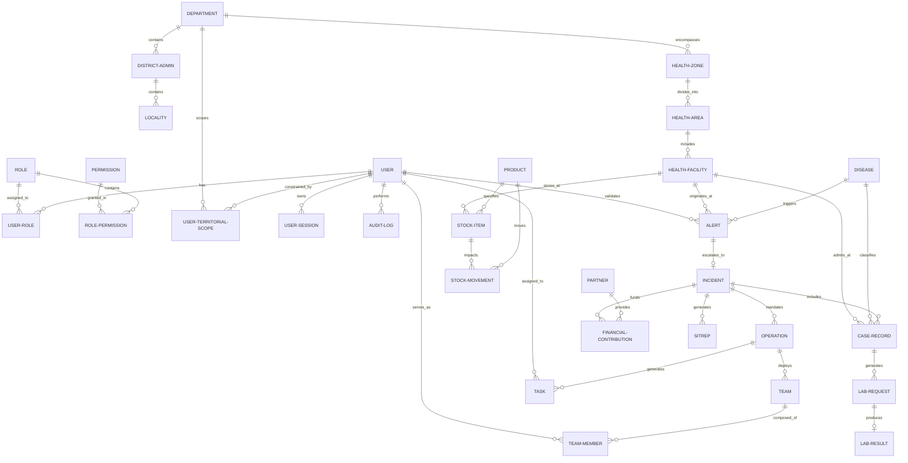

# Modélisation Intégrale de la Base de Données COUSP-MIS (PostgreSQL / PostGIS)
**République du Congo – Ministère de la Santé et de la Population**

---

## 1. Modèle Conceptuel de Données (MCD)

### 1.1 Entités Métier et Définitions

1. **RÉFÉRENTIEL TERRITORIAL & SANITAIRE**
   - **DEPARTMENT** : 12 départements souverains de la République du Congo (Brazzaville, Pointe-Noire, Kouilou, Niari, Bouenza, Lékoumou, Pool, Plateaux, Cuvette, Cuvette-Ouest, Sangha, Likouala).
   - **DISTRICT_ADMIN** : Subdivisions administratives territoriales (communes, districts).
   - **LOCALITY** : Villes, villages, communautés et campements ruraux.
   - **HEALTH_ZONE (District Sanitaire)** : Découpage opérationnel de la Direction Départementale des Soins et Services de Santé (DDSSS).
   - **HEALTH_AREA (Aire de Santé)** : Périmètre sanitaire de proximité couvrant une population cible.
   - **HEALTH_FACILITY (Formation Sanitaire - FOSA)** : Hôpitaux généraux, hôpitaux de référence, Centres de Santé Intégrés (CSI), Postes de Santé, Laboratoires nationaux/régionaux, Centres de Traitement Épidémique (CTE).

2. **IAM & HABILITATIONS (RBAC + ABAC TERRITORIAL)**
   - **USER** : Agents de santé, épidémiologistes, coordinateurs, logisticiens, biologistes.
   - **ROLE** : Profils de responsabilité (SUPER_ADMIN, COUSP_DIRECTOR, EPIDEMIOLOGIST, LAB_TECH, LOGISTICIAN, FIELD_AGENT, PARTNER_OBSERVER).
   - **PERMISSION** : Droits atomiques (ressource:action) ex: `alerts:validate`, `incidents:activate_level3`, `stocks:emergency_dispatch`.
   - **USER_TERRITORIAL_SCOPE** : Confinement géographique strict interdisant la consultation croisée non autorisée entre départements.
   - **USER_SESSION** : Sessions actives, hachages de tokens de rafraîchissement et révocation.
   - **AUDIT_LOG** : Journalisation immuable de traçabilité médico-légale et administrative.

3. **SURVEILLANCE ÉPIDÉMIOLOGIQUE & ALERTES**
   - **DISEASE** : Pathologies prioritaires sous surveillance SIMR (CIM-11, incubation, seuils d'alerte et épidémique).
   - **SURVEILLANCE_REPORT** : Bulletins de surveillance hebdomadaires intégrés (SIMR) par aire et district de santé.
   - **ALERT** : Signalements horodatés avec identifiant unique `ALT-YYYYMMDD-XXXX`, qualification clinique, niveau de criticité et workflow de validation/rejet.

4. **INCIDENTS & GESTION DES OPÉRATIONS (IMS / COUSP)**
   - **INCIDENT** : Urgence de santé publique déclarée avec coordinateur désigné et niveau de réponse (Niveau 1 Vigilance, Niveau 2 Alerte, Niveau 3 Urgence Majeure).
   - **OPERATION** : Missions opérationnelles (investigation rapide, campagne de vaccination réactive, désinfection, recherche active de contacts).
   - **TEAM & TEAM_MEMBER** : Équipes d'intervention rapide (RRT) pluridisciplinaires déployées sur le terrain.
   - **TASK** : Ordres de mission et tâches opérationnelles avec criticité et échéances.

5. **CAS CLINIQUES & LABORATOIRE**
   - **CASE_RECORD** : Fiche épidémiologique individuelle pseudonymisée, statut clinique (suspect, probable, confirmé, invalidé) et issue clinique.
   - **LAB_REQUEST** : Demandes d'analyses biologiques avec traçabilité de la chaîne de froid.
   - **LAB_RESULT** : Résultats des analyses (PCR, TDR, séquençage, culture) avec valeurs Ct et validation formelle par biologiste.

6. **LOGISTIQUE D'URGENCE, STOCKS & FINANCES**
   - **PRODUCT** : Médicaments, vaccins, EPI, tests de diagnostic, réactifs, matériels de réanimation.
   - **STOCK_ITEM** : Quantités stockées par FOSA, lot, date de péremption, stocks de sécurité.
   - **STOCK_MOVEMENT** : Mouvements transactionnels (réceptions, transferts, dotations d'urgence, consommations) avec garantie atomique anti-solde négatif.
   - **PARTNER & FINANCIAL_CONTRIBUTION** : Bailleurs de fonds, agences des Nations Unies (OMS, UNICEF) et contributions budgétées en Francs CFA (XAF).

7. **SITREP & PLANS D'URGENCE**
   - **SITREP** : Rapports de situation officiels (Situation Reports) consolidés pour les autorités nationales et internationales.
   - **EMERGENCY_PLAN & SOP_DOCUMENT** : Procédures Opérationnelles Standards et plans de contingence.

---

### 1.2 Schéma des Relations et Cardinalités (Mermaid)

---

## 2. Modèle Logique de Données (MLD)

Toutes les relations obéissent aux règles de normalisation en 3ème Forme Normale (3FN).

1. `departments` (**id** [UUID], code [VARCHAR(10) UNIQUE], name [VARCHAR(100) UNIQUE], capital [VARCHAR(100)], population [INT], latitude [FLOAT], longitude [FLOAT], created_at [TIMESTAMPTZ], updated_at [TIMESTAMPTZ])
2. `districts_admin` (**id** [UUID], department_id [UUID -> departments.id], code [VARCHAR(20) UNIQUE], name [VARCHAR(100)], type [VARCHAR(50)], created_at [TIMESTAMPTZ])
3. `localities` (**id** [UUID], district_admin_id [UUID -> districts_admin.id], name [VARCHAR(150)], type [VARCHAR(50)], latitude [FLOAT], longitude [FLOAT], created_at [TIMESTAMPTZ])
4. `health_zones` (**id** [UUID], department_id [UUID -> departments.id], code [VARCHAR(20) UNIQUE], name [VARCHAR(100)], headquarter [VARCHAR(100)], population [INT], latitude [FLOAT], longitude [FLOAT], created_at [TIMESTAMPTZ], updated_at [TIMESTAMPTZ])
5. `health_areas` (**id** [UUID], health_zone_id [UUID -> health_zones.id], code [VARCHAR(20) UNIQUE], name [VARCHAR(100)], population [INT], created_at [TIMESTAMPTZ], updated_at [TIMESTAMPTZ])
6. `health_facilities` (**id** [UUID], health_area_id [UUID -> health_areas.id], code [VARCHAR(20) UNIQUE], name [VARCHAR(150)], type [ENUM], level [INT], contact_phone [VARCHAR(50)], latitude [FLOAT], longitude [FLOAT], created_at [TIMESTAMPTZ], updated_at [TIMESTAMPTZ])
7. `users` (**id** [UUID], email [VARCHAR(150) UNIQUE], password_hash [VARCHAR(255)], first_name [VARCHAR(100)], last_name [VARCHAR(100)], phone [VARCHAR(50)], title [VARCHAR(100)], organization [VARCHAR(150)], status [ENUM], failed_login_attempts [INT], last_login_at [TIMESTAMPTZ], created_at [TIMESTAMPTZ], updated_at [TIMESTAMPTZ])
8. `roles` (**id** [UUID], name [VARCHAR(100) UNIQUE], slug [VARCHAR(50) UNIQUE], description [VARCHAR(255)], is_system [BOOLEAN], created_at [TIMESTAMPTZ], updated_at [TIMESTAMPTZ])
9. `permissions` (**id** [UUID], resource [VARCHAR(50)], action [VARCHAR(50)], description [VARCHAR(255)], created_at [TIMESTAMPTZ], **UNIQUE(resource, action)**)
10. `user_roles` (**user_id** [UUID -> users.id], **role_id** [UUID -> roles.id], created_at [TIMESTAMPTZ])
11. `role_permissions` (**role_id** [UUID -> roles.id], **permission_id** [UUID -> permissions.id])
12. `user_territorial_scopes` (**id** [UUID], user_id [UUID -> users.id], department_id [UUID NULL -> departments.id], health_zone_id [UUID NULL -> health_zones.id], facility_id [UUID NULL -> health_facilities.id], is_national [BOOLEAN])
13. `sessions` (**id** [UUID], user_id [UUID -> users.id], refresh_token_hash [VARCHAR(255)], ip_address [VARCHAR(45)], user_agent [VARCHAR(255)], is_revoked [BOOLEAN], expires_at [TIMESTAMPTZ], created_at [TIMESTAMPTZ])
14. `diseases` (**id** [UUID], code [VARCHAR(20) UNIQUE], name [VARCHAR(100) UNIQUE], icd11_code [VARCHAR(20)], incubation_period_days [INT], epidemic_threshold [INT], alert_threshold [INT], case_definition [TEXT], created_at [TIMESTAMPTZ])
15. `surveillance_reports` (**id** [UUID], reporting_year [INT], epi_week [INT], health_facility_id [UUID -> health_facilities.id], disease_id [UUID -> diseases.id], cases_count [INT], deaths_count [INT], submitted_by_id [UUID -> users.id], submitted_at [TIMESTAMPTZ], **UNIQUE(health_facility_id, disease_id, reporting_year, epi_week)**)
16. `alerts` (**id** [UUID], alert_number [VARCHAR(30) UNIQUE], disease_id [UUID -> diseases.id], health_facility_id [UUID -> health_facilities.id], reporter_name [VARCHAR(100)], reporter_contact [VARCHAR(50)], reporter_type [VARCHAR(50)], suspected_cases [INT], suspected_deaths [INT], description [TEXT], reported_at [TIMESTAMPTZ], status [ENUM], severity [ENUM], validated_by_id [UUID NULL -> users.id], validated_at [TIMESTAMPTZ NULL], rejection_reason [TEXT NULL], created_at [TIMESTAMPTZ], updated_at [TIMESTAMPTZ])
17. `incidents` (**id** [UUID], incident_number [VARCHAR(30) UNIQUE], title [VARCHAR(200)], source_alert_id [UUID NULL UNIQUE -> alerts.id], disease_id [UUID -> diseases.id], primary_department_id [UUID -> departments.id], activation_level [ENUM], status [ENUM], incident_commander_id [UUID -> users.id], started_at [TIMESTAMPTZ], closed_at [TIMESTAMPTZ NULL], closing_summary [TEXT NULL], created_at [TIMESTAMPTZ], updated_at [TIMESTAMPTZ])
18. `operations` (**id** [UUID], incident_id [UUID -> incidents.id], code [VARCHAR(30) UNIQUE], name [VARCHAR(150)], type [VARCHAR(50)], start_date [TIMESTAMPTZ], end_date [TIMESTAMPTZ NULL], budget_xaf [DOUBLE PRECISION], created_at [TIMESTAMPTZ], updated_at [TIMESTAMPTZ])
19. `teams` (**id** [UUID], operation_id [UUID -> operations.id], name [VARCHAR(100)], specialty [VARCHAR(100)], created_at [TIMESTAMPTZ])
20. `team_members` (**id** [UUID], team_id [UUID -> teams.id], user_id [UUID -> users.id], role_in_team [VARCHAR(100)], deployed_at [TIMESTAMPTZ])
21. `tasks` (**id** [UUID], operation_id [UUID -> operations.id], assigned_to_user_id [UUID NULL -> users.id], assigned_to_team_id [UUID NULL -> teams.id], title [VARCHAR(200)], description [TEXT NULL], priority [ENUM], status [ENUM], due_date [TIMESTAMPTZ NULL], completed_at [TIMESTAMPTZ NULL], created_at [TIMESTAMPTZ], updated_at [TIMESTAMPTZ])
22. `case_records` (**id** [UUID], case_identifier [VARCHAR(40) UNIQUE], incident_id [UUID -> incidents.id], disease_id [UUID -> diseases.id], health_facility_id [UUID -> health_facilities.id], patient_pseudonym [VARCHAR(100)], age_years [INT], gender [ENUM], residence_department [VARCHAR(100)], residence_district [VARCHAR(100)], onset_date [TIMESTAMPTZ], admission_date [TIMESTAMPTZ], classification [ENUM], outcome [ENUM], outcome_date [TIMESTAMPTZ NULL], created_at [TIMESTAMPTZ], updated_at [TIMESTAMPTZ])
23. `lab_requests` (**id** [UUID], request_number [VARCHAR(40) UNIQUE], case_record_id [UUID -> case_records.id], sample_type [VARCHAR(100)], collection_date [TIMESTAMPTZ], cold_chain_maintained [BOOLEAN], status [ENUM], created_at [TIMESTAMPTZ], updated_at [TIMESTAMPTZ])
24. `lab_results` (**id** [UUID], lab_request_id [UUID UNIQUE -> lab_requests.id], test_method [VARCHAR(100)], pathogen_detected [VARCHAR(100) NULL], result_status [ENUM], ct_value [FLOAT NULL], analyzed_by [VARCHAR(100)], validated_by [VARCHAR(100)], validated_at [TIMESTAMPTZ])
25. `products` (**id** [UUID], code [VARCHAR(30) UNIQUE], name [VARCHAR(150) UNIQUE], category [VARCHAR(100)], unit_of_measure [VARCHAR(50)], storage_condition [VARCHAR(50)], minimum_alert_stock [INT], created_at [TIMESTAMPTZ])
26. `stock_items` (**id** [UUID], health_facility_id [UUID -> health_facilities.id], product_id [UUID -> products.id], batch_number [VARCHAR(50)], expiry_date [TIMESTAMPTZ], quantity_available [INT], quantity_reserved [INT], created_at [TIMESTAMPTZ], updated_at [TIMESTAMPTZ], **UNIQUE(health_facility_id, product_id, batch_number)**)
27. `stock_movements` (**id** [UUID], movement_number [VARCHAR(40) UNIQUE], product_id [UUID -> products.id], batch_number [VARCHAR(50)], quantity [INT], movement_type [ENUM], source_facility [VARCHAR(150) NULL], dest_facility [VARCHAR(150) NULL], reason [TEXT NULL], created_at [TIMESTAMPTZ])
28. `partners` (**id** [UUID], name [VARCHAR(150) UNIQUE], type [VARCHAR(100)], contact_person [VARCHAR(100) NULL], email [VARCHAR(150) NULL], phone [VARCHAR(50) NULL], created_at [TIMESTAMPTZ])
29. `financial_contributions` (**id** [UUID], partner_id [UUID -> partners.id], incident_id [UUID -> incidents.id], amount_xaf [DOUBLE PRECISION], purpose [TEXT], grant_reference [VARCHAR(100) NULL], disbursed_date [TIMESTAMPTZ])
30. `sitreps` (**id** [UUID], sitrep_number [VARCHAR(40) UNIQUE], incident_id [UUID -> incidents.id], reporting_period_start [TIMESTAMPTZ], reporting_period_end [TIMESTAMPTZ], total_cases [INT], new_cases [INT], total_deaths [INT], new_deaths [INT], response_summary [TEXT], gaps_and_challenges [TEXT NULL], recommendations [TEXT NULL], status [ENUM], prepared_by [VARCHAR(100)], approved_by [VARCHAR(100) NULL], approved_at [TIMESTAMPTZ NULL], created_at [TIMESTAMPTZ], updated_at [TIMESTAMPTZ])
31. `emergency_plans` (**id** [UUID], code [VARCHAR(30) UNIQUE], title [VARCHAR(200)], hazard_type [VARCHAR(100)], version [VARCHAR(20)], document_url [VARCHAR(255)], status [VARCHAR(50)], approved_at [TIMESTAMPTZ NULL], created_at [TIMESTAMPTZ])
32. `audit_logs` (**id** [UUID], user_id [UUID NULL -> users.id], action [VARCHAR(100)], resource [VARCHAR(100)], resource_id [UUID NULL], old_values [JSONB NULL], new_values [JSONB NULL], ip_address [VARCHAR(45) NULL], user_agent [VARCHAR(255) NULL], timestamp [TIMESTAMPTZ DEFAULT NOW()])

---

## 3. Contraintes d'Intégrité & Déclencheurs Métier

- **Intégrité Référentielle Stricte** : `ON DELETE CASCADE` pour les données dépendantes (rôles-permissions, sessions, membres d'équipes), `ON DELETE RESTRICT` pour les incidents, alertes, fiches de cas et mouvements de stock afin de prohiber toute suppression d'antécédents épidémiologiques ou médico-légaux.
- **Contrainte Anti-Stock Négatif** : `CHECK (quantity_available >= 0)` et `CHECK (quantity_reserved >= 0)`.
- **Contrainte Cohérence Chronologique** : `CHECK (reporting_period_end >= reporting_period_start)`, `CHECK (admission_date >= onset_date)`.
- **Indexation Haute Performance** :
  - Index composites sur `alerts (status, reported_at, disease_id)`
  - Index sur `case_records (incident_id, classification, outcome)`
  - Index sur `stock_items (health_facility_id, product_id)`
  - Index sur `audit_logs (user_id, timestamp)`

